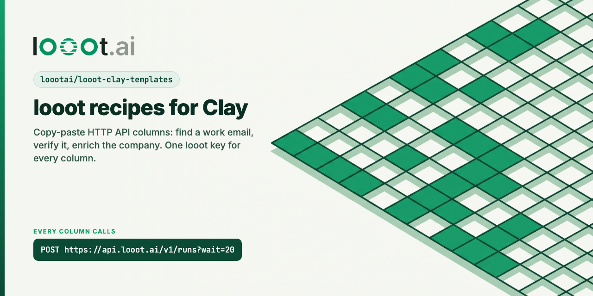
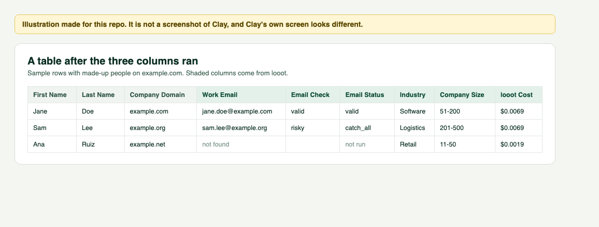

<p align="center"></p>

# looot-clay-templates

[](LICENSE) [](https://docs.looot.ai)

Copy-paste recipes that call [looot](https://looot.ai) from a Clay table with Clay's HTTP API column.
looot is one key and one prepaid balance for 2,500+ data endpoints from 90+ providers. Each recipe is one
column: you paste a URL and a JSON body, and looot picks a provider, falls back to the next one when the
first finds nothing, and charges only the attempts that ran.

There is no native looot integration in Clay. These recipes use the HTTP API column that Clay already
has, so they work today with your own looot token.

| Recipe | looot job | Cheapest per call on 2026-10-08 | Page |
|---|---|---|---|
| Find work email | `people.email.find` | $0.003598 | [recipes/find-work-email.md](recipes/find-work-email.md) |
| Verify email | `people.email.verify` | $0.00145 | [recipes/verify-email.md](recipes/verify-email.md) |
| Enrich company | `company.enrich` | $0.0019 | [recipes/enrich-company.md](recipes/enrich-company.md) |

Prices come from the public catalog, `GET https://api.looot.ai/v1/catalog/overview?depth=jobs`, read on
2026-10-08. They change. `npm run test:live` compares the numbers in this repo with the catalog.



*Illustration made for this repo. It is not a screenshot of Clay.*

## Set it up

### 1. Save your looot token once

Create a token in the looot dashboard under Settings, Agent tokens, with `catalog.read`, `runs.read`,
`runs.execute` and `usage.read`. Check it from a terminal. This call is free:

```bash
curl -s https://api.looot.ai/v1/balance -H "Authorization: Bearer $LOOOT_TOKEN"
```

In Clay, open any HTTP API column, then Select header account, Add account. Under API Request Headers add:

| Key | Value |
|---|---|
| `Authorization` | `Bearer <your looot agent token>` |

Name the account `looot` and save. Clay stores these headers encrypted for the workspace. Do not type the
token into the Headers field of a column, where it shows in plain text.

### 2. Add a column per recipe

Add column, Add enrichment, HTTP API. Fill the fields from the recipe page. Every recipe uses the same
request and only the body changes:

| Field | Value |
|---|---|
| Method | `POST` |
| API endpoint URL | `https://api.looot.ai/v1/runs` |
| Query string parameters | `wait` = `20` |
| Select header account | `looot` |
| Remove empty fields from request | On |

Insert a column into the body with `/Column Name`, inside quotes for text: `"domain": "/Company Domain"`.

Test on one row before you run the table.

### 3. Map the answer

looot answers with the run. The parts worth a column:

| Field path | What it is |
|---|---|
| `normalized.fields.*` | The same field names whichever provider answered. See [normalized output](https://docs.looot.ai/concepts/normalized-output) |
| `status` | `completed`, `failed`, `blocked` or `stopped`. `queued` or `running` when the lookup took longer than `wait` |
| `actualCost` | What this row cost, in USD |
| `runId` | Read the run again with `GET https://api.looot.ai/v1/runs/{runId}` |
| `error.message` | Why a run failed. looot answers HTTP 201 for a run that failed before it started, so read `status`, not the HTTP code |

`normalized` is missing when the provider that answered has no field map. Add `result` to the field paths
to get the provider's raw answer.

## What a table costs

Add the three per-call prices for a rough floor: $0.003598 + $0.00145 + $0.0019 = $0.006948 per row, about
$6.95 per 1,000 rows, when the cheapest provider answers each time. Fallback can raise a row up to the
`maxCostUsd` in each body ($0.05, $0.02, $0.02). Rows where a call fails cost nothing. Top up from $5,
no subscription.

## Not checked yet

These recipes were written from Clay's HTTP API documentation and looot's API. They have not been run
inside a Clay table, because that needs a Clay account. The request itself is the same one the looot n8n
node and the docs use. Check on one row first:

1. Clay sends the body with the column values in place and drops the empty ones.
2. The field paths under `normalized.fields` come back as expected.
3. A lookup that takes more than 20 seconds returns `status: running`. Raise `wait` (up to 60) if Clay's
   own timeout allows it.

## In this repo

```
recipes/<name>.md          the page to follow
recipes/<name>.body.json   the JSON body alone, to paste
recipes/<name>.json        the whole recipe as data
illustrations/             HTML drawings of the settings and their PNGs (not Clay screenshots)
scripts/                   rebuild the pages and the drawings from the recipe data
test/                      checks the bodies against looot's request shape
```

```bash
npm test             # 19 checks, offline
npm run test:live    # also compares prices with the public looot catalog (free call)
```

Output on 2026-10-08, Node 24.18.0: `npm test` 19 pass, 1 skipped. `npm run test:live` 20 pass.
No test runs a paid looot call.

## Docs used

- Clay HTTP API column: https://university.clay.com/docs/http-api-integration-overview, read on 2026-10-08
- looot run request: https://api.looot.ai/openapi.json (`RunRequest`), https://docs.looot.ai/concepts/job-inputs

## Related

- [looot-zapier](https://github.com/loootai/looot-zapier), [looot-make](https://github.com/loootai/looot-make), [n8n-nodes-looot](https://github.com/loootai/n8n-nodes-looot): looot on automation tools.
- [looot-tables](https://github.com/loootai/looot-tables): open-source enrichment tables on looot.
- [awesome-gtm](https://github.com/loootai/awesome-gtm): open-source GTM tools.

MIT, copyright looot. Clay is a trademark of its owner; this repo is not affiliated with or endorsed by Clay.
