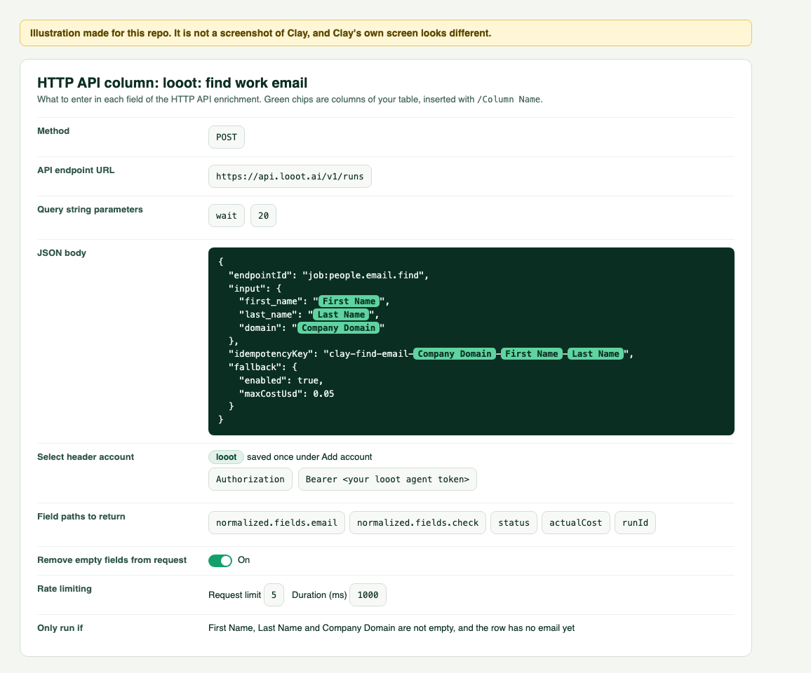

# Find work email in Clay with looot

Adds a column that runs looot's `people.email.find` job for each row.



*Illustration made for this repo. It is not a screenshot of Clay.*

## Cost per row

Priced on 2026-10-08 from the public catalog (`GET https://api.looot.ai/v1/catalog/overview?depth=jobs`):

| | |
|---|---|
| Cheapest provider, per call | $0.003598 |
| Cheapest provider billed per result | $0.019 |
| Providers looot can try | 17 |
| Cap in this recipe (`fallback.maxCostUsd`) | $0.05 per row |

A row costs the price of the providers that ran. With fallback on, looot moves to the next provider when
one finds nothing, so a hard row can cost more than the cheapest price, never more than the cap. A failed
call costs nothing. Each row's real cost comes back in `actualCost`. Clay may also charge its own
credits for an HTTP API column; Clay's HTTP API page does not state a number, so check your plan.

## Columns your table needs

- `First Name`
- `Last Name`
- `Company Domain`

Rename the `/Column Name` references in the body if your columns have other names.

## Settings

In your table: Add column, Add enrichment, HTTP API.

| Field | Value |
|---|---|
| Method | `POST` |
| API endpoint URL | `https://api.looot.ai/v1/runs` |
| Query string parameters | `wait` = `20` |
| Select header account | `looot` (see [the README](../README.md#1-save-your-looot-token-once)) |
| Field paths to return | `normalized.fields.email`, `normalized.fields.check`, `status`, `actualCost`, `runId` |
| Remove empty fields from request | On |
| Rate limiting | Request limit `5`, Duration (ms) `1000` |
| Only run if | First Name, Last Name and Company Domain are not empty, and the row has no email yet |

JSON body, also in [`find-work-email.body.json`](find-work-email.body.json):

```json
{
  "endpointId": "job:people.email.find",
  "input": {
    "first_name": "/First Name",
    "last_name": "/Last Name",
    "domain": "/Company Domain"
  },
  "idempotencyKey": "clay-find-email-/Company Domain-/First Name-/Last Name",
  "fallback": {
    "enabled": true,
    "maxCostUsd": 0.05
  }
}
```

## Map the answer to columns

| New column | Field path |
|---|---|
| Work Email | `normalized.fields.email` |
| Email Check | `normalized.fields.check` |
| looot Cost | `actualCost` |

## Notes

- The email is in `normalized.fields.email`. `normalized.fields.check` is `valid`, `invalid`, `catch_all`, `risky` or `unknown`. A row where looot found nothing has no `normalized.fields.email`; the column stays empty.
- No domain? Replace `"domain": "/Company Domain"` with `"company": "/Company Name"`. A LinkedIn URL works too: `"linkedin_url": "/LinkedIn URL"`.
- One column for the name? Use `"name": "/Full Name"` in place of the two name fields.
- The `idempotencyKey` is built from the row's own values. Running the same row again returns the first
  run and costs nothing. To force a fresh lookup, change the prefix, for example add `-v2`.
