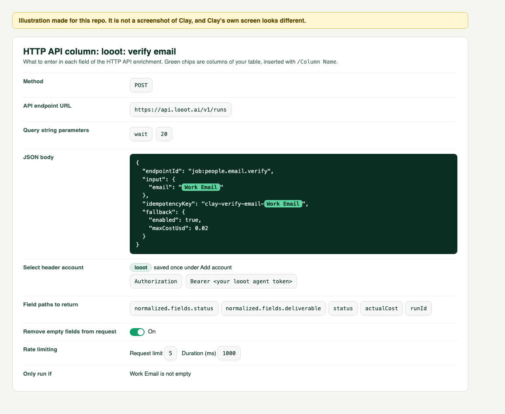

# Verify email in Clay with looot

Adds a column that runs looot's `people.email.verify` job for each row.



*Illustration made for this repo. It is not a screenshot of Clay.*

## Cost per row

Priced on 2026-10-08 from the public catalog (`GET https://api.looot.ai/v1/catalog/overview?depth=jobs`):

| | |
|---|---|
| Cheapest provider, per call | $0.00145 |
| Cheapest provider billed per result | not listed |
| Providers looot can try | 13 |
| Cap in this recipe (`fallback.maxCostUsd`) | $0.02 per row |

A row costs the price of the providers that ran. With fallback on, looot moves to the next provider when
one finds nothing, so a hard row can cost more than the cheapest price, never more than the cap. A failed
call costs nothing. Each row's real cost comes back in `actualCost`. Clay may also charge its own
credits for an HTTP API column; Clay's HTTP API page does not state a number, so check your plan.

## Columns your table needs

- `Work Email`

Rename the `/Column Name` references in the body if your columns have other names.

## Settings

In your table: Add column, Add enrichment, HTTP API.

| Field | Value |
|---|---|
| Method | `POST` |
| API endpoint URL | `https://api.looot.ai/v1/runs` |
| Query string parameters | `wait` = `20` |
| Select header account | `looot` (see [the README](../README.md#1-save-your-looot-token-once)) |
| Field paths to return | `normalized.fields.status`, `normalized.fields.deliverable`, `status`, `actualCost`, `runId` |
| Remove empty fields from request | On |
| Rate limiting | Request limit `5`, Duration (ms) `1000` |
| Only run if | Work Email is not empty |

JSON body, also in [`verify-email.body.json`](verify-email.body.json):

```json
{
  "endpointId": "job:people.email.verify",
  "input": {
    "email": "/Work Email"
  },
  "idempotencyKey": "clay-verify-email-/Work Email",
  "fallback": {
    "enabled": true,
    "maxCostUsd": 0.02
  }
}
```

## Map the answer to columns

| New column | Field path |
|---|---|
| Email Status | `normalized.fields.status` |
| Deliverable | `normalized.fields.deliverable` |
| looot Cost | `actualCost` |

## Notes

- `normalized.fields.status` is `valid`, `invalid`, `catch_all`, `risky` or `unknown`. `normalized.fields.deliverable` is `true` or `false`, and only present when the provider reports it.
- Run this column after the find column, on its Work Email output, and filter your send list on `valid`.
- The `idempotencyKey` is built from the row's own values. Running the same row again returns the first
  run and costs nothing. To force a fresh lookup, change the prefix, for example add `-v2`.
